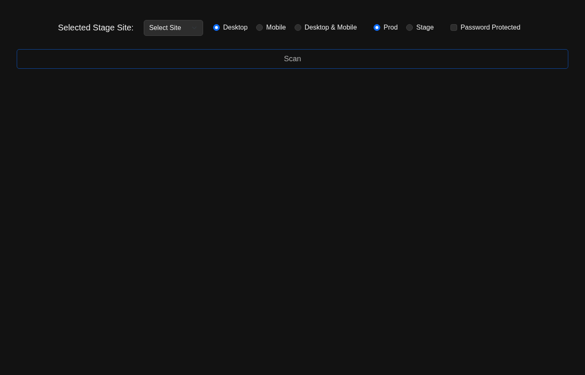
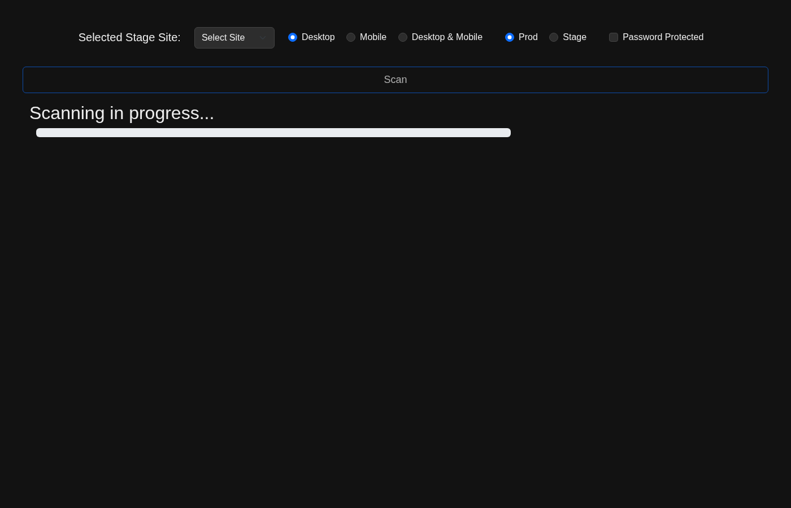

# 📄 BetterPrintToPDF — Automated Full-Page Screenshot & PDF Stitched Engine

[](https://www.python.org/)
[](https://www.selenium.dev/)
[](https://python-pillow.org/)
[](https://pypdf.readthedocs.io/)

A high-performance Python utility for capturing pixel-perfect, full-page scrolling screenshots of complex web applications and assembling them into print-ready, vectorized or rasterized PDF reports with customizable pre- and post-capture automation hooks.

---

## 📸 Screenshots

<p align="center">
  
  
</p>

---

## ✨ Key Features

- **Full-Page Stitched Capture:** Seamlessly handles scroll-jacking, dynamic sticky headers, infinite scroll, and floating navbars without visual tearing.
- **Pre-Capture Automation Hooks:**
  - Automatically dismisses cookie banners (e.g. OneTrust), newsletter pop-ups, and GDPR modals via CSS/XPath selectors.
  - Injects custom CSS to hide non-printable UI elements (chat widgets, sticky headers, fixed floating banners).
  - Waits for lazy-loaded assets, fonts, and WebGL/Canvas elements to finish rendering.
- **Dual Viewport Emulation:** Captures both desktop (1920×1080) and mobile responsive viewports with accurate device pixel ratios.
- **Multithreaded Concurrent Batch Processing:** Process batches of target URLs concurrently with isolated browser sessions.
- **Flexible Document Assembly:** Stitches image slices seamlessly and encodes them directly into high-fidelity PDFs via `Pillow` and `pypdf`.

---

## 🚀 Quick Start

```bash
# Clone the repository
git clone https://github.com/ryguy0601/betterPrintToPDF.git
cd betterPrintToPDF

# Install dependencies
pip install -r requirements.txt

# Run screenshot capture pipeline
python main.py --url "https://example.com" --output "output.pdf"
```

---

## 🛠 Tech Stack

- **Core Engine:** Python 3.9+
- **Browser Automation:** Selenium WebDriver, Chrome DevTools Protocol (CDP)
- **Image Stitching:** Pillow (PIL Fork)
- **PDF Compilation:** pypdf, reportlab
